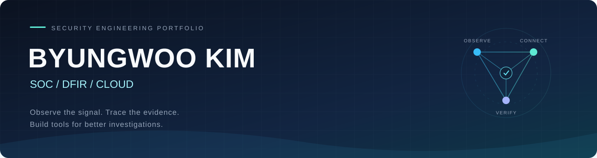
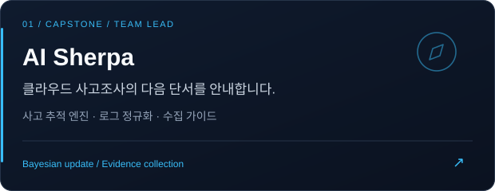
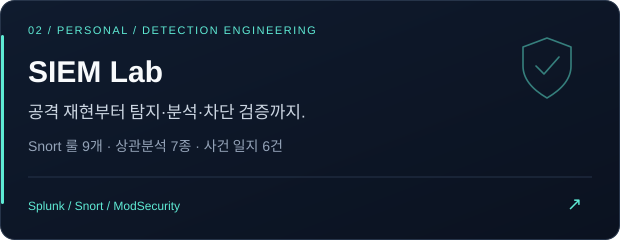
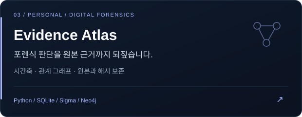
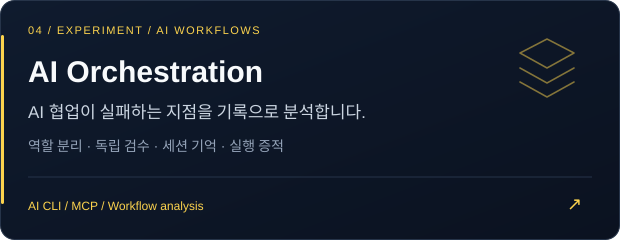

  

  

<b>로그에서 공격의 흐름을 읽고, 조사 과정을 도구로 만듭니다.</b>

  
  

 

### About me

**김병우** · 보안관제와 침해사고 대응을 공부하며, 공격 재현·탐지 분석·증거 탐색을 연결하는 도구를 만듭니다.

- 🎓 **세종대학교 정보보호학과** — 2027년 2월 졸업 예정
- 🌱 **KISIA 청년취업사관학교(SeSAC)** — AI를 활용한 보안전문가 양성과정 수료
- 🔎 **관심 분야** — SOC · 탐지 엔지니어링 · 디지털포렌식 · 클라우드 사고조사

 

### Tech stack

  

  
  
  
  
  
  
  

프로젝트에서 활용한 기술입니다. 적용 범위는 <a href="docs/PROJECT_DETAILS.md#skills--practice">상세 경험</a>에 정리했습니다.

 

### Selected work

조사 설계, 공격·탐지 실험, 증거 분석과 AI 협업까지 직접 만든 결과물입니다.

AI Sherpa는 정보보호 캡스톤 팀 프로젝트, SIEM·Evidence Atlas는 개인 프로젝트입니다. Atlas의 AWS 확장은 코드·로컬 검증 단계이며 실제 AWS에는 미배포 상태입니다.

📚 [SeSAC 학습 아카이브](https://github.com/acvbbnm/sesac-study-notes) · [프로젝트별 담당 범위와 배운 점](docs/PROJECT_DETAILS.md#selected-projects)

 

### GitHub activity

  
  

현재 계정의 공개 활동과 저장소 언어 구성입니다. 언어 비중은 숙련도 지표가 아닙니다.

 

<b>관측과 판단을 구분하고, 모든 분석에 돌아갈 근거를 남깁니다.</b>

<a href="https://cooperative-cave-e9b.notion.site/41c70716154e81b289fde409f3bae4c9">프로젝트 문서와 실습 증적은 Notion에서 →</a>

