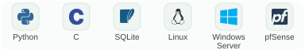

<h2 align="center">김병우</h2>

침해사고 대응 · 디지털 포렌식 · 모의해킹

<strong>Contact</strong>

<a href="https://cooperative-cave-e9b.notion.site/41c70716154e81b289fde409f3bae4c9"> Notion</a>

<a href="mailto:kbw11111@naver.com">kbw11111@naver.com</a>

## Skills

<strong>Computing</strong> 

<strong>Security</strong> 

## 프로젝트

- [SIEM Lab](https://github.com/acvbbnm/siem-project)
- [Evidence Atlas](https://github.com/acvbbnm/dfir)
- [AI Sherpa](https://github.com/acvbbnm/cloud)

## 아카이브

[AI 오케스트레이션](https://github.com/acvbbnm/ai_orchestration) · [SeSAC 학습 기록](https://github.com/acvbbnm/sesac-study-notes) · [학교 학습 기록](https://github.com/acvbbnm/school-study-notes) · [실습 상세](docs/PROJECT_DETAILS.md#practice)
